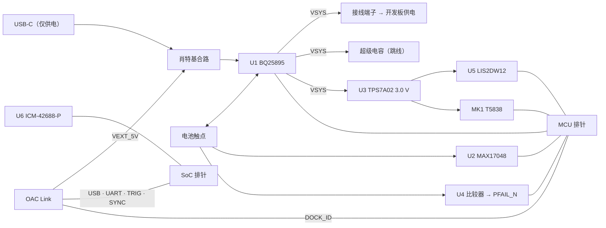

# P0 伴随板（oac-p0-companion）

接在 RV1126B 开发板和 nRF54L15 开发板之间的一块验证板。它包含系统中与 SoC 无关的电路，这些电路验证后会搬进 Core 主板。

**状态：原理图初稿（代码形式），规则检查通过；引脚编号未核对；PCB 未布局；未打样。**

## 它验证什么

| 验证内容 | 伴随板提供的条件 |
|---|---|
| 整机功耗 | `VSYS_OUT` 上的 20 mΩ 检流电阻和测试点 |
| IMU 同步 | 主 IMU，`FSYNC` 接传感器帧同步信号 |
| 标准电池 | 电池触点、温度和识别引脚、电压型电量计 |
| 掉电保持 | 可跳线接入的超级电容、电池欠压比较器、仓门开关输入 |
| 常开域功耗 | 加速度计、声学唤醒麦克风；常开电源轨上的电流测量跳线 |
| 接口与演示 | OAC Link 全部 10 个信号；录制指示灯硬件联动的演示电路 |

## 框图



## 文件

| 文件 | 说明 |
|---|---|
| `companion.py` | 原理图（唯一的事实来源） |
| `parts.py` | 器件定义：引脚、封装、料号 |
| `out/companion.net` | KiCad 网表，Pcbnew 可导入 |
| `out/bom.csv` | BOM |
| `out/netlist.md` | 按网络列出的可读网表 |
| `out/pin-review.csv` | 引脚核对清单 |
| `pcb-constraints.md` | PCB 设计约束 |

重新生成（只需要 Python 3.8+，无第三方依赖）：

```bash
python3 hardware/p0-companion/companion.py
```

规则检查的内容：每个引脚都已连接或显式声明悬空；电源输入引脚所在网络有电源驱动；同一网络没有多个输出；没有只有一个节点的网络。**它不检查引脚编号对不对，也不检查电路功能。**

## 设计说明

**充电（U1）**
- `D+` 与 `D-` 短接，芯片把输入识别为专用充电口；实际输入电流由 `ILIM` 电阻限制在约 2 A（200 Ω，换算系数待对照数据手册）。
- 充电截止电压使用上电默认值 4.208 V，对任何 1S 锂电池都安全。提高电压由 MCU 在识别电池后通过 I2C 设置。
- `OTG` 接地，不使用升压输出。
- 温度检测网络（5.23 kΩ / 30.1 kΩ）取自数据手册针对 10 kΩ NTC 的典型值，待核对。没有 NTC 的电池短接 JP1，用 10 kΩ 固定电阻代替；这时没有温度保护，只用于测试。

**电量计（U2）**：选型理由见 [../power-tree.md](../power-tree.md)。

**掉电检测（U4）**：电池电压经 1 MΩ / 619 kΩ 分压后与 1.242 V 基准比较，阈值约 3.25 V，10 MΩ 提供迟滞。分压常耗约 2.4 µA。

**电平转换（Q1、Q2）**：`PFAIL_N` 和 `BAT_DOOR_N` 在常开域是 3.0 V 电平，送往 SoC 时用 N 沟道管转换到 `VIO_SOC`。SoC 断电时管子关断，不会倒灌。

**主 IMU（U6）**：由开发板的 IO 电源 `VIO_SOC` 供电，电平自然与 SoC 匹配。`XVS_IN` 需要从传感器模组上飞线引出；同一根线也要接到开发板的一个 GPIO 上，作为第二时间锚点。

**录制指示灯**：`SENSOR_AVDD`（传感器模拟供电，从模组上飞线）经三极管直接点亮 LED，不经过任何固件。这里只是演示原理，正式电路在传感器板上。

## 排针定义

以 `out/netlist.md` 为准。摘要：

- **MCU 排针 J6**：`AON_3V0`、I2C、充电中断 / 使能 / QON、电量计告警、加速度计中断 ×2、麦克风时钟 / 数据 / 唤醒 / 阈值、马达使能、`DOCK_ID`、`BAT_ID`、`BAT_DOOR_N`、`PFAIL_N`。nRF54L15 开发板的 IO 电压需设为 3.0–3.3 V。
- **SoC 排针 J7**：`VIO_SOC`（由开发板提供）、IMU 的 SPI 和中断、`XVS_IN`、OAC Link 的 USB / UART / 触发 / 同步、`PFAIL_N_SOC`、`BAT_DOOR_N_SOC`、`SENSOR_AVDD`。
- **J4 接线端子**：`VSYS_OUT`（3.5–4.4 V）。只有当开发板或核心板接受单节锂电池电压输入时才能直接供电，否则要另加升压，这一点选定核心板后确认。

## 打样前必须完成

- [ ] `out/pin-review.csv` 中每个器件对照数据手册核对引脚编号（T5838 的编号是占位值）
- [ ] 核对 ICM-42688-P 保留引脚的接法
- [ ] 核对 BQ25895 的 `ILIM` 系数和温度网络阻值
- [ ] 核对超级电容、USB-C 座、麦克风的料号
- [ ] 建 `OAC:` 开头的封装
- [ ] 请硬件工程师评审原理图
