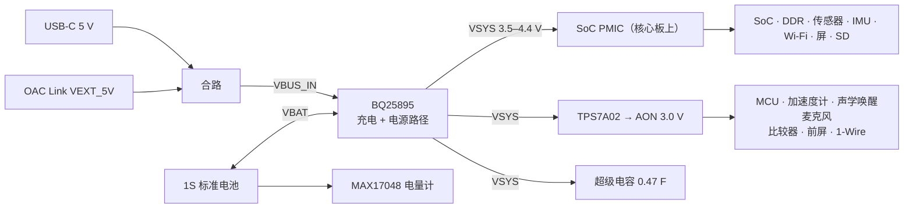

# 电源树（草案 0.1）

所有数字是设计目标或估算，未经实测。

## 电源轨

| 电源轨 | 电压 | 来源 | 负载 | 电流预算 |
|---|---|---|---|---|
| `VBUS_IN` | 约 4.6–5.2 V | USB-C 或 OAC Link | 充电芯片 | 输入限流约 2 A |
| `VBAT` | 3.0–4.45 V | 电池 | 充电芯片、电量计 | 放电 ≤ 1.5 A |
| `VSYS` | 3.5–4.4 V | 充电芯片电源路径 | 核心板、AON LDO、马达、超级电容 | 录制约 0.8 A（2.8 W ÷ 3.6 V） |
| `AON_3V0` | 3.0 V | TPS7A02 | 常开域 | 待机 < 80 µA；MCU 工作时数 mA |
| 主电源域各轨 | — | 核心板 PMIC | SoC 等 | 以核心板参考设计为准 |

## 几个器件选择的理由

- **电量计用 MAX17048 而不是 BQ27220。** 相机使用市售标准电池，电芯型号不固定。BQ27220 需要针对具体电芯做参数学习，换一家电池就不准；MAX17048 按电压建模，不需要检流电阻和学习。代价是精度一般，不提供电流读数。P0 用几家电池对比后再定。
- **常开电源轨取 3.0 V。** 电池放到 3.3 V 时 LDO 仍有余量；Memory LCD 前屏需要 3 V；1-Wire 器件在 3 V 下选择更多。
- **两路 5 V 用肖特基合路**只是 P0 的做法，压降约 0.3–0.4 V。Core 主板上要换成理想二极管或电源选择芯片。

## 掉电保持

需求：电池被拔出后，保证当前分片写完并同步文件系统，按 150 ms 计。

| 条件 | 计算 | 需要的电容 |
|---|---|---|
| 不切负载，2.8 W，3.8 → 3.3 V | 0.42 J ÷ ½(3.8² − 3.3²) | 约 0.24 F |
| 切负载到 0.5 W，3.8 → 3.3 V | 0.075 J ÷ 1.78 | 约 42 mF |
| 切负载到 0.5 W，电池低电 3.5 → 3.3 V | 0.075 J ÷ 0.68 | 约 110 mF |

取 0.22–0.47 F。两点容易忽略：

1. **ESR 比容量更关键。** 0.5 W 时电流约 150 mA，纽扣型超级电容的内阻常在几十欧，一带载电压就塌掉，完全不能用。必须选低内阻型号（目标 < 0.5 Ω）。
2. **体积不小。** 低内阻的 0.47 F / 5.5 V 器件约 21 × 14 × 3 mm（型号和尺寸待核实），对 Core 的布局影响很大。可行性验证要回答的问题之一，就是切负载后最小能用多大的电容。

伴随板上超级电容经跳线接入，可以带和不带对比测试。
